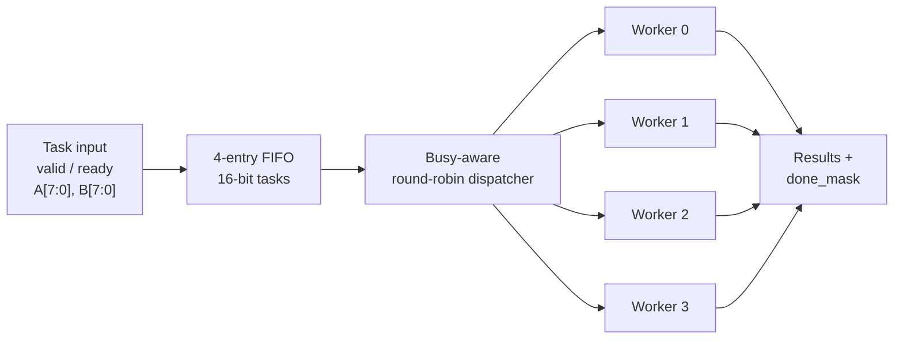

# Four-Worker Task Scheduler (Verilog)

A simulation-based **four-worker task scheduler** built in Verilog, with a four-entry FIFO, ready/valid flow control, busy-aware round-robin dispatch, independent worker execution, and an interactive Python test runner.

The current processing operation is **unsigned 8-bit addition** (`A + B`, with a 9-bit result). It is a digital design and verification project—not a CPU/GPU implementation or an FPGA throughput benchmark.

## Architecture



Each worker latches the sum at acceptance and **models a five-cycle busy interval** before asserting `done` for one cycle. This is simulated task latency, *not* a five-cycle arithmetic pipeline. The scheduler skips busy workers, and a queued task waits until a worker can accept it.

## Features

- Four independent workers and a **busy-aware round-robin** dispatcher
- Four-slot, first-in-first-out input queue
- Input backpressure (`in_valid` / `in_ready` handshake)
- Per-worker `busy_mask`, `done_mask`, and 9-bit result lanes
- Directed module/integration testbenches and VCD waveform traces
- Interactive custom-task entry, output verification, and simulated performance reporting

## Quick start (Windows / MSYS2 UCRT64 / VS Code)

Requires **Python 3**, **Icarus Verilog** (`iverilog` and `vvp`), and optionally **GTKWave**. Ensure they are on your terminal's PATH.

In MSYS2 UCRT64, install tools if necessary:

```bash
pacman -S mingw-w64-ucrt-x86_64-iverilog mingw-w64-ucrt-x86_64-gtkwave
```

Clone and run from the repository root:

```bash
git clone https://github.com/adhyayan15/four-worker-task-scheduler.git
cd four-worker-task-scheduler
python run_tasks.py
```

Example input:

```text
Task 1 (A B / run): 22 33
Task 2 (A B / run): 22 33
Task 3 (A B / run): 89 73
Task 4 (A B / run): run
```

The script generates `user_tasks.hex`, compiles the RTL and testbench with `iverilog`, runs the design with `vvp`, checks each result, and writes `interactive_wave.vcd`. If GTKWave is installed, it offers to open the waveform. Input: **1–256 tasks**, two unsigned numbers from **0–255** per task.

## Verification

To run directed tests manually from the repository root:

```bash
iverilog -g2012 -s busy_worker_tb -o busy_sim.vvp busy_worker.v tests/busy_worker_tb.v
vvp busy_sim.vvp

iverilog -g2012 -s task_fifo_tb -o fifo_sim.vvp task_fifo.v tests/task_fifo_tb.v
vvp fifo_sim.vvp

iverilog -g2012 -s parallel_scheduler_tb -o parallel_sim.vvp busy_worker.v parallel_scheduler.v tests/parallel_scheduler_tb.v
vvp parallel_sim.vvp

iverilog -g2012 -s queued_scheduler_tb -o queued_sim.vvp busy_worker.v parallel_scheduler.v task_fifo.v queued_scheduler.v tests/queued_scheduler_tb.v
vvp queued_sim.vvp
```

An additional integration testbench (`user_tasks_tb.v`) checks FIFO ordering and per-task results from a user-created task file. See [Verification](docs/VERIFICATION.md).

## Observed simulation results

These are from uploaded simulation output and VCD files, **not hardware measurements**.

| Experiment | Observation |
| --- | --- |
| Queued integration simulation | **20 accepted / 20 dispatched / 20 completed** |
| Interactive example (3 tasks) | **3 / 3 correct results** |
| Interactive example average end-to-end latency | **6 cycles / 60 ns** |
| Interactive example elapsed time | **9 simulated cycles / 90 ns** |
| Interactive example throughput at **assumed 100 MHz** | **33.33 million tasks/s** |
| Interactive example worker utilization | **41.7%** |
| Interactive example peak FIFO use | **1 of 4 entries** |

The 100 MHz clock comes from the testbench's 10 ns period. No synthesis, place-and-route, FPGA deployment, timing closure, or power analysis has been performed. Results depend on workload size and spacing, and short three-task averages should not be interpreted as sustained throughput. See [Performance and limitations](docs/PERFORMANCE.md).

## Repository layout

```text
busy_worker.v                 Latency-modeled arithmetic worker
parallel_scheduler.v          Round-robin, busy-aware dispatcher
task_fifo.v                   Four-entry task FIFO
queued_scheduler.v            Integrated FIFO + dispatcher + workers
run_tasks.py                  Interactive CLI runner
user_tasks_tb.v               Self-checking custom workload testbench
tests/                       Directed unit and integration testbenches
examples/                    Earlier single-worker and round-robin stages
docs/                        Architecture, verification, and metrics
.github/workflows/            Continuous simulation checks
```

## Learnings and next steps

**Demonstrated:** RTL module composition, sequential logic, handshakes and backpressure, arbitration, FIFO control, independent task execution, self-checking simulation, VCD waveform analysis, and basic workload metrics.

**Potential next steps:** configurable arithmetic/logic operations, parameterized worker/queue counts, longer randomized tests, synthesis with Yosys, and timing/resource analysis on a target FPGA.

For design trade-offs and known limitations, read [Architecture](docs/ARCHITECTURE.md). This repository intentionally omits generated `.vvp`/`.vcd` files from version control: regenerate them using the supplied scripts and testbenches.
